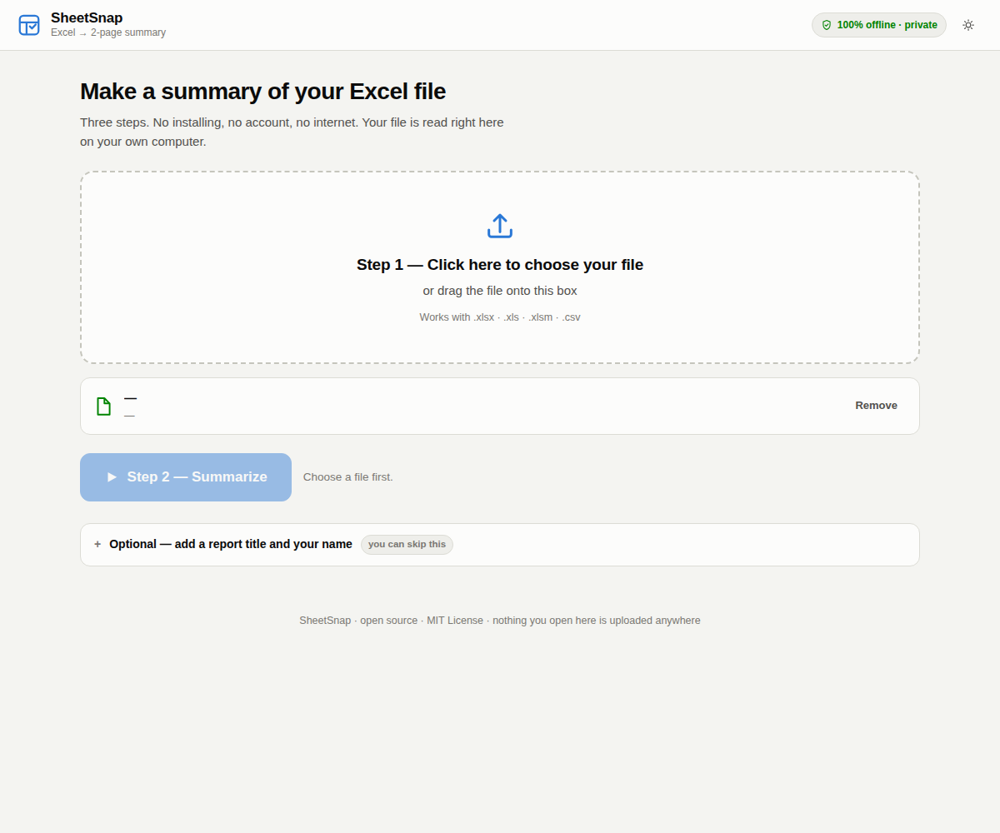
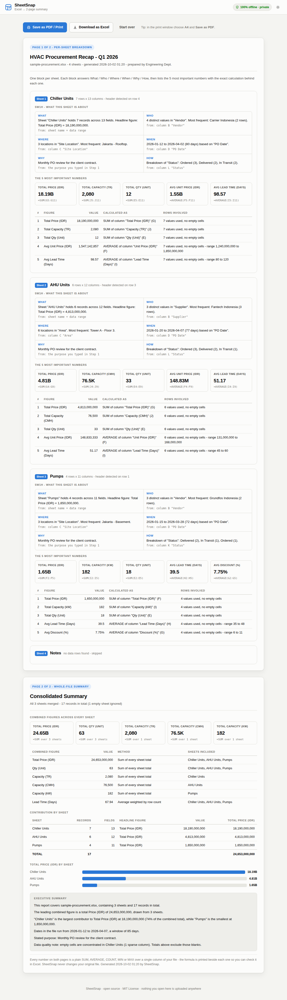

<div align="center">

# SheetSnap

**Drop in an Excel file. Press one button. Get a clean 2-page summary.**

No installing. No account. No internet. One file, and it works in any folder.

[](LICENSE)
[](#is-my-data-safe)
[](#how-to-use-it-3-steps)

</div>

---

## What is this?

You have an Excel file. Maybe it has one sheet, maybe it has twelve. Someone asks
you: *"So what does it say?"*

SheetSnap reads your file and writes the answer for you — a tidy report you can
print, email, or hand to your boss.

**You do not need to know anything about Excel, coding, or computers.** If you can
open a file, you can use this.

---

## How to use it (3 steps)

### Step 0 — Get the file (you only do this once)

1. Click the green **Code** button at the top of this page.
2. Click **Download ZIP**.
3. Open the ZIP and drag **`SheetSnap.html`** anywhere you like — your Desktop,
   a USB stick, a shared drive. Anywhere is fine.

> **Only want the one file?** Open [`SheetSnap.html`](SheetSnap.html), click the
> **Download raw file** button (the ⬇ icon at the top right of the file view),
> and you're done. That single file *is* the whole app.

### Step 1 — Open it

Double-click `SheetSnap.html`. It opens in your normal web browser
(Chrome, Edge, Safari, Firefox — whichever one you already have).

You do **not** need to be online. You can be on a plane.

### Step 2 — Choose your Excel file

Click the big dashed box, or just drag your Excel file onto it.

<div align="center">
  
</div>

### Step 3 — Press **Summarize**

That's it. Your report appears.

<div align="center">
  
</div>

Then you can:

| Button | What it does |
|---|---|
| **Save as PDF / Print** | Opens your normal print window. Choose **A4** and **Save as PDF**. |
| **Download as Excel** | Saves the summary as a new `.xlsx` file, so you can keep working on it. |
| **Start over** | Clears everything and lets you summarize a different file. |

---

## What the report looks like

The report is always **2 parts**.

### Page 1 — one block for every sheet

For each sheet in your file, you get:

**The 5W1H panel** — six plain-English answers about that sheet:

| | Answer SheetSnap writes |
|---|---|
| **What** | How many records and fields the sheet holds, and its headline figure. |
| **Who** | The people, vendors or customers found in the sheet, and the most frequent one. |
| **Where** | The locations, sites or areas found in the sheet. |
| **When** | The oldest and newest date, and how many days that covers. |
| **Why** | The purpose you typed in Step 1, or a purpose column found in the file. |
| **How** | The breakdown of payment terms, status or category columns. |

**The 5 most important numbers** — and for each one, *exactly how it was calculated*:

> **Total Price (IDR) — 18,190,000,000**
> `=SUM(G5:G11)`
> SUM of column "Total Price (IDR)" (G) · 7 values used, no empty cells

Nothing is a black box. Every number names its column, its formula, and how many
rows went into it, so you can check it yourself in Excel in ten seconds.

If your workbook has many sheets, page 1 simply continues onto more printed
sheets. One block per sheet, always complete.

### Page 2 — the whole file in one page

Always **exactly one A4 page**. This is the page you show your boss.

- **Combined figures** across every sheet (columns with the same name are added
  up together automatically).
- **Contribution by sheet** — a table showing what each sheet brought to the total.
- **A comparison chart** — which sheet is biggest, at a glance.
- **An executive summary** written in sentences, including a note about data
  quality (where empty cells are hiding).

---

## Is my data safe?

**Yes. Your file never leaves your computer.**

SheetSnap has no server. There is nothing to log in to. When you press
**Summarize**, your file is read into your browser's memory, summarized, and
forgotten the moment you close the tab.

You can prove it yourself: **turn off your Wi-Fi, then use the app.** It works
exactly the same. Nothing is uploaded, because there is nowhere to upload to.

The only thing stored on your computer is whether you picked light or dark mode.

### What about viruses or malicious files?

SheetSnap reads your file with a well-known open-source spreadsheet library.
That library has two publicly reported weaknesses in the version bundled here,
and we would rather tell you than hide it:

- **A crafted file could try to tamper with the page's internals.** SheetSnap
  locks those internals before it reads anything, so this cannot land. The test
  suite proves it by feeding SheetSnap a booby-trapped file and checking that
  nothing runs.
- **A crafted file could make the tab freeze.** This one is not fixed. Closing
  the tab ends it, and nothing is damaged — but it is a real limitation.

Plain advice, the same as for Excel: open files from people you trust.

Full technical detail: [THIRD-PARTY-NOTICES.md](THIRD-PARTY-NOTICES.md).

---

## What files does it accept?

`.xlsx` · `.xls` · `.xlsm` · `.xlsb` · `.csv` · `.tsv` · `.ods`

Want to try it before using your real data? Use the example file in this repo:
[`examples/sample-procurement.xlsx`](examples/sample-procurement.xlsx) — a
realistic purchase-order workbook with three sheets.

---

## Getting the best results

SheetSnap works with no setup at all. But it reads a tidy file better than a messy
one, so:

| Do this | Why it helps |
|---|---|
| Give each column a **title in one row** | That row becomes the field names. A logo or title above it is fine — SheetSnap looks past it. |
| Keep **one table per sheet** | Two tables side by side on one sheet will confuse any tool, including this one. |
| Let **numbers be numbers** | A cell holding `1.250.000 IDR` as text cannot be added up. A cell holding `1250000` can. |
| Use **real dates**, not text | Then the "When" answer and the time-span figure work. |

Helpful column names (English or Indonesian both work) let SheetSnap guess better:
`Total`, `Price`, `Harga`, `Qty`, `Jumlah`, `Vendor`, `Supplier`, `Location`,
`Lokasi`, `Date`, `Tanggal`, `Status`, `Payment Term`, `Lead Time`, `Capacity`.

---

## Frequently asked questions

**Do I need to install Excel?**
No. SheetSnap reads the file by itself. Excel is not involved at all.

**Do I need Python, Node, or anything like that?**
No. Nothing. One file, your browser, done.

**Will my antivirus complain?**
No. It is an ordinary web page file, not a program you install.

**Can I put it on a shared drive for my whole team?**
Yes. Copy `SheetSnap.html` anywhere. Every person who opens it gets their own
private copy running in their own browser.

**It says "no data rows found" for one of my sheets.**
That sheet has no table — usually it's a notes or cover tab. SheetSnap skips it
on purpose and tells you so, rather than inventing numbers.

**One of the five numbers isn't the one I wanted.**
SheetSnap ranks columns by what their names suggest (money first, then capacity,
quantity, duration, percentage). Rename the column you care about to something
clearer — for example `Total Contract Value` — and it will move to the top.

**Why did it average my discount column instead of adding it up?**
Because adding up percentages is meaningless. Percentages, durations and per-unit
prices are averaged; money, quantities and capacities are summed. The method is
printed beside every number.

**It won't open / the page is blank.**
Your browser is likely very old. SheetSnap needs a browser from roughly 2020 or
later. Updating Chrome, Edge, Firefox or Safari fixes it.

---

## For developers

Users never need this section.

```
SheetSnap.html          the built, self-contained app — this is what people download
src/index.html          page structure
src/app.css             styles, including the A4 print rules
src/app.js              the whole engine: header detection, column profiling,
                        metric selection, 5W1H, consolidation, rendering, export
src/vendor/             SheetJS 0.18.5 (Apache-2.0), bundled so the app works offline
build.mjs               inlines src/* into SheetSnap.html
tools/make-example.mjs  regenerates examples/sample-procurement.xlsx
tools/smoke-test.mjs    drives the real built file in a real browser and checks the output
```

```bash
npm install     # only needed for building and testing
npm run build   # rebuild SheetSnap.html after editing anything in src/
npm test        # build, then run the browser checks
```

`npm test` opens the built file in headless Chromium with **all network requests
blocked**, loads the example workbook, and asserts on what actually rendered —
including that the cross-sheet grand total is arithmetically correct and that
page 2 still fits on exactly one A4 sheet.

If Playwright's browser is already installed elsewhere on your machine:

```bash
SHEETSNAP_CHROMIUM=/path/to/chrome npm test
```

**Always run `npm run build` before committing.** `SheetSnap.html` is a build
artifact that is committed on purpose — that is what makes the repo
download-and-go.

---

## Licence

[MIT](LICENSE) — free to use, change and share, at work or anywhere else.

Bundled library credits: [THIRD-PARTY-NOTICES.md](THIRD-PARTY-NOTICES.md).

Contributions are welcome — see [CONTRIBUTING.md](CONTRIBUTING.md).
